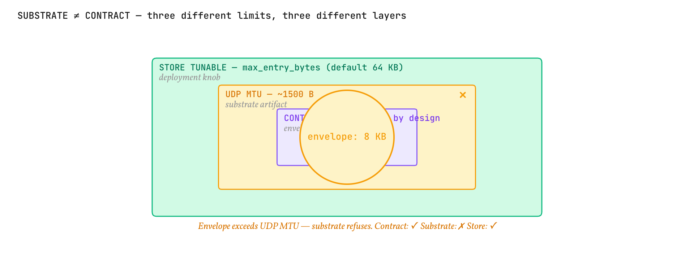
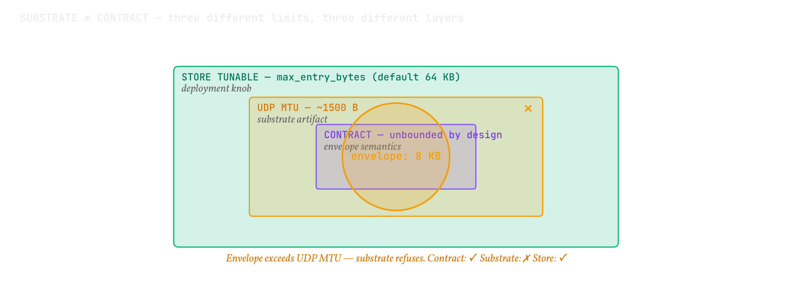

# Substrate versus contract

<b>Explanation</b> · for anyone who has met a "maximum envelope size" somewhere in the tree and wants to know whether it is part of the format

**The claim.** The envelope contract has no size limit, and every limit a reader meets belongs to the substrate that is carrying the envelope at that moment. Keeping the two apart is what lets one wire format run over a datagram, a shared-memory ring and a daemon socket without three definitions of an envelope.

<figure class="pm-figure">
  
  
  <figcaption>Figure A18 · substrate versus contract · one contract, three substrates, three limits</figcaption>
</figure>

## The mechanism

The canonical bytes of an envelope are a function of its fields and nothing else; the specification says so and the vectors prove it. A limit on how many of those bytes a particular medium can carry is a fact about the medium. Three such facts exist in this tree, each recorded where it applies:

| Limit | Medium | Where it is recorded |
|---|---|---|
| 1,315 bytes | One datagram of the reference UDP transport: a 1,472-byte path less the 153-byte frame header and the 4-byte CRC. | `pulse-wire-udp`, as `MAX_ENVELOPE`; a sender refuses a larger envelope at encode time unless fragmentation is switched on at both ends, when an envelope up to `MAX_MESSAGE` (66,560 bytes) travels as a run of datagrams and is reassembled; the limit moves, and stays the transport's. |
| 65,536 bytes | One entry of the envelope store. | The store's header, so a reader attaching to a store learns the deployment's limit without being told. |
| The daemon's frame cap | One message on a daemon connection. | The daemon's connection policy. |

An implementation that carries envelopes over a medium with no such limit, shared memory between two processes for instance, MUST NOT impose one, and a transport that refuses an envelope its medium cannot hold is not violating the contract; it is reporting a property of itself.

The same separation runs through the rest of the design. The ring's slot size is a substrate fact and the Pulse's 128 bytes are a contract fact; they coincide by construction, and a version-2 slot that adds a ready line changes the substrate without touching the Pulse. The daemon's protocol version and the standard's draft revision are two counters because they change for two reasons.

## Why it matters

Confusing the two produces the wrong fix in both directions. Raising an envelope limit "in the format" to suit one transport would force every other implementation to change for a property it does not have; lowering one to match the smallest medium would forbid what shared memory carries for free. Naming the limit after its medium keeps each change local.

## What would refute this

A conformant decoder that rejects an envelope for its size alone, or a substrate limit that had to be written into the canonical bytes to be enforced, would refute the separation. The codec's tests decode envelopes far larger than any substrate limit, and the transport's tests refuse at the transport, not in the codec.

## Spoken walkthrough

*A script for the video and audio version of this page, about a minute.*

Somewhere in the tree you meet a maximum envelope size. Is it part of the format? No. The format has no size limit; the medium carrying the envelope at that moment does.

A UDP datagram carries about thirteen hundred bytes of envelope, or about sixty-five kilobytes if you switch fragmentation on at both ends. A store entry carries sixty-four kilobytes, and says so in its header. A daemon connection carries what its policy allows. Shared memory between two processes carries whatever you like, and an implementation on a medium with no limit must not invent one.

Keeping the two apart is what lets one wire format run over a datagram, a ring and a socket without three definitions of an envelope. Raise a limit in the format to suit one transport, and every other implementation changes for a property it does not have. Name the limit after its medium, and each change stays local.
