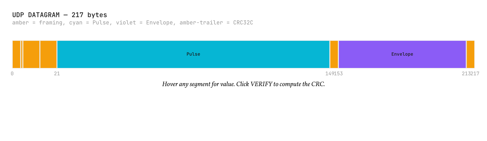
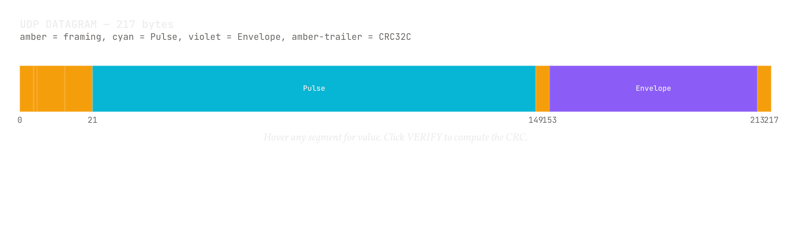

# Trust boundaries

<b>Explanation</b> · for anyone deploying Pulse Mesh beyond one trusted machine, and for anyone auditing what protects what

**The claim.** Pulse Mesh's integrity mechanisms detect corruption and prove content; they authenticate no one. Authentication and encryption exist, each opt-in and each at a named place: sealed UDP between nodes that know each other's keys, TLS and proven keys on the daemon's remote surfaces, and node keys on the links between daemons. Where none is switched on, the host's own boundaries are the only ones, and this page says where those are.

<figure class="pm-figure">
  
  
  <figcaption>Figure A14 · the CRC sweep · what the checksum covers, and what it cannot mean</figcaption>
</figure>

## What the integrity mechanisms prove

The CRC on a datagram detects accidental corruption in transit. It is not a signature: anyone who can send a datagram can compute a valid CRC, so a matching CRC means the bytes arrived as sent, not that a trusted party sent them. The envelope identifier proves that the content is what its name says; it does not say who produced the content, because the origin is deliberately outside the preimage. The SeqLock proves that a reader's copy is one writer's complete write; it assumes every process mapped into the region is trusted, because any of them could write anywhere in it. The Pulse's `chain_step` and `preimage` fields are reserved for a replay defence that is not implemented in this release, so a Pulse carries no replay protection of its own. `preimage` is unused; carriers reuse `chain_step` (core-ring marks overruns in it, and the daemon's links carry their hop limit in it), which proves nothing about who sent a Pulse. Replay is refused where sealing is on, at the transport, as the next section says.

## What authenticates and encrypts, and where

Each of these is opt-in, by ADR-0018. Plaintext stays the default where the host already protects the path: shared memory, the Unix socket and loopback.

**Sealed UDP, between nodes that know each other's keys.** A node holds one long-term X25519 key, generated on first start into a file only its owner can read, and is identified by its public key, not its name; peers are admitted by an allowlist of keys. Two nodes run a Noise IK handshake (`Noise_IK_25519_ChaChaPoly_BLAKE2s`, through the `snow` crate), then every datagram, whatever the transport would have sent in the clear, is encrypted and authenticated whole with ChaCha20-Poly1305, 36 bytes of overhead, and the inner frame keeps its CRC. A receiver drops a datagram whose seal counter is older than a window of 2,048 or already seen inside it, so replay is refused at the transport; sessions rekey every two minutes and are dropped after three idle periods; a node configured for sealing refuses plaintext from any address that is not loopback. The cryptographic-engineering review that ADR-0018 item 9 requires has not been done, so sealed mode is not yet recommended for production, and the module says so in its own documentation.

**The daemon's remote surfaces.** The WebSocket is plaintext on loopback by default. With `--ws-tls-cert` and `--ws-tls-key` it is `wss://`: TLS 1.3 through `rustls`, which encrypts the connection and authenticates the daemon to clients that trust the certificate. With `--attach-keys`, a client attaching over the WebSocket must present a listed Ed25519 public key and answer the daemon's challenge with a proof of it, and is then named by the key; `--attach-keys-uds` asks the same of the Unix socket. A `--ws-bind` on an address other than loopback is refused unless both are given, or unless `--ws-allow-remote` says the gap is meant, in which case the daemon logs a warning naming what is missing.

**Links between daemons.** A daemon's links to other daemons run on sealed UDP only, keyed by its node key, and only the configured peers' keys are admitted, each from the IP of the address its `--link-peer` names; a peer named by its key alone (`--link-peer-key`) is admitted from whatever address its handshake comes from, its key authenticated as any peer's is. Nothing signs an envelope or its origin end to end, so what a relay says about where a forwarded send came from is as trustworthy as the relay, and a daemon takes relayed traffic only from a peer it names with `--link-trust-relay`. The capability Hello is the first message of each link session, inside the sealed session, so a path attacker cannot strip or forge its bits; on plain UDP nothing sends the Hello yet, and nothing acts on an agreed upgrade yet.

**The enterprise ring's TLS stage.** The sender verifies the server's certificate and name against the roots it is given; the receiver authenticates no client. A deployment that must know who connects puts that control in front of the port.

## Where the boundaries are without them

**Shared memory.** A ring, a region and a store are POSIX objects created with owner-only permissions; every process that can open them is a peer with full write access. The boundary is the operating system's: users and namespaces.

**The daemon on its defaults.** `mesh-hub` serves two local surfaces, and they reach different peers. The Unix socket is created with owner-only permissions, so only processes of the daemon's own user, and root, can attach through it. The WebSocket listens on the loopback interface, which keeps it off the network but not away from the host's other users: any process on the machine, whatever its user, can connect to it, and on its defaults the connection is plaintext and the client proves nothing. On a host other users share, that leaves `--attach-keys`, so that a WebSocket client must prove a listed key, or `--no-ws`, so that the daemon serves the Unix socket alone. Any attached client may publish to any channel and subscribe to any filter: the daemon registers no schemas, so on its defaults there is no authorisation, and without `--attach-keys` no identity beyond the name a client chooses. Of the clients, only the Rust client (`mesh-client`, `MeshOptions::with_identity`) proves a key today; `pms`, the MCP server and the Python and Node thin clients attach by name, so a surface that requires keys refuses them with `auth_failed`.

**The UDP transport in plaintext.** A data socket accepts a valid frame from any source. The feedback socket, which drives backpressure and retransmission, accepts acknowledgements and retransmission requests from any source unless `BackpressureConfig::feedback_peer` names one, when feedback from anyone else is dropped and counted. Source addresses can be forged, so the filter is a mitigation, not a boundary. A forged acknowledgement can only raise the sender's cursor, which releases its stall; a forged request can only cost one bounded retransmission to the sender's own destination. Every amplifier is bounded by design.

## What is deliberately absent

Per-channel authorisation is in no layer, and any attached client may subscribe to anything. The one control on publishing is per envelope type: a hub that registers a schema with a producer list (`mesh-schema`, through the hub's API; the daemon's flags register none) refuses that type from any other node, by key when clients prove keys at attach. A schema's consumer list is recorded and not enforced. Nothing signs an envelope's origin end to end. Neither is in the substrate because the standard's contract is the bytes, and a second thing to agree on before the bytes could agree would be a second standard; authority above the transport belongs to the layers the Sovereignty stack puts around it, or to the deployment.

## What would refute this

A deployment guide that presented the CRC or the identifier as authentication; a daemon that bound a routable address without TLS and attach keys and without a warning; a sealed receiver that accepted a replayed datagram, or a plaintext frame from a non-loopback address; a link that admitted an unlisted key, or relayed traffic from a peer not named as a relay; or a feedback path with an unbounded amplifier would each contradict this page. The transport's sealed-decode fuzz target and replay tests, the daemon's attach-key and `--ws-allow-remote` tests, the link tests and the feedback-filter and queue-bound tests are the checks for the mechanisms; the first claim is checked by reading the code this page cites.

## Spoken walkthrough

*A script for the video and audio version of this page, about ninety seconds.*

Three things in Pulse Mesh prove something, and none of them proves who you are talking to. The checksum proves the bytes arrived as sent. The identifier proves the content is what its name says. The ring's counter proves a reader got one writer's whole write. Useful, and not authentication.

Authentication and encryption exist, but you switch them on, at a named place. Between machines over UDP, sealing: each node has a key, peers are listed by key, and every datagram is encrypted and authenticated, replays refused. On the daemon's WebSocket, TLS for the connection and a proven key for the client. On the links between daemons, the same node keys. Two caveats come with the first: the independent review the design requires has not happened yet, so sealed mode is not yet recommended for production; and a relay's word about where a message came from is only as good as the relay, so you name the relays you trust.

Where nothing is switched on, the boundaries are the host's: who can open the shared memory, who can reach the socket. And one thing is in no layer at all: per-channel permission. A client that may attach may publish on any channel. That is the deployment's to add, and this page is where it says so.
